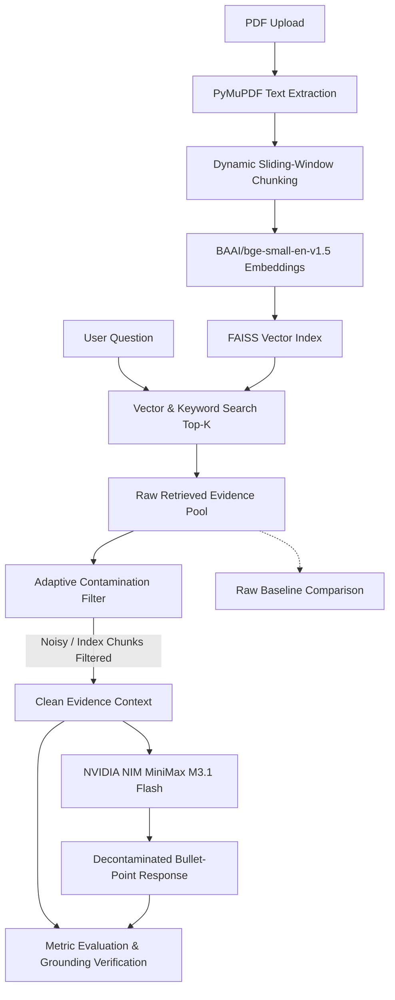

# PDF RAG Intelligence System: Reducing Context Contamination in LLM Retrieval

An advanced Retrieval-Augmented Generation (RAG) system engineered to mitigate **context contamination**, eliminate hallucinations, and deliver evidence-grounded answers across diverse document domains including **General QA**, **Medicine Profiles**, and **Legal Defense Strategy**.

Powered by **FAISS**, **BAAI/bge-small-en-v1.5 Embeddings**, PyMuPDF, and **NVIDIA NIM** (MiniMax M3.1 Flash).

---

## Key Features

- **Adaptive Context Contamination Filtering**:
  Intelligently filters out noisy, weak, and redundant chunks from retrieval pools using semantic relevance thresholds, lexical protection, and glossary/index shielding—preventing distraction and hallucinations in LLM generation.
- **Multi-Domain Intelligence**:
  Unified architecture with specialized domain intelligence layers:
  - **General PDF QA**: Technical whitepapers, research articles, manuals, resumes.
  - **Medical Report & Medicine Profile**: Clinical findings, indications, contraindications, and drug profile analysis.
  - **Legal Defense Strategy**: Statutory section analysis, procedural defense strategies, and case fact extraction.
- **Comprehensive Evaluation Benchmark**:
  Real-time before-and-after filtering metrics comparing:
  - **Contamination Reduction Rate (%)**
  - **Semantic Overlap & Accuracy** (Precision, Recall, F1)
  - **Generation Metrics**: BLEU score & ROUGE (ROUGE-1, ROUGE-2, ROUGE-L)
  - **Perplexity Scoring** via Causal LM
- **Fast Mode**:
  Streamlined execution path completing retrieval, adaptive filtering, and decontaminated generation in **3–7 seconds**.
- **Interactive Web Interface**:
  Built with Streamlit, providing real-time evidence diff visualization, KPI metrics cards, and document analysis tabs.

---

## System Architecture



---

## Quick Start Guide

### Prerequisites
- Python 3.10+ (macOS, Linux, or Windows)
- An NVIDIA NIM API key (available at [NVIDIA API Catalog](https://build.nvidia.com/explore/discover))

### 1. Clone the Repository
```bash
git clone https://github.com/Varun-0731/Reducing-contest-contamination-llm.git
cd Reducing-contest-contamination-llm
```

### 2. Set Up Virtual Environment
```bash
# On Linux / macOS:
python3 -m venv .venv
source .venv/bin/activate

# On Windows (PowerShell):
python -m venv .venv
.venv\Scripts\Activate.ps1
```

### 3. Install Dependencies
```bash
pip install --upgrade pip
pip install -r requirements.txt
```

### 4. Configure Environment Variables
Copy `.env.example` to `.env`:
```bash
cp .env.example .env
```
Edit `.env` and set your configuration:
```env
NVIDIA_API_KEY=nvapi-your_api_key_here
NVIDIA_MODEL=minimaxai/minimax-m3.1-flash
NVIDIA_BASE_URL=https://integrate.api.nvidia.com/v1
FAST_MODE=true
```

---

## Running the Application

### Streamlit Web UI
Launch the interactive web application:
```bash
streamlit run app.py
```
Open **[http://localhost:8501](http://localhost:8501)** in your browser.
1. Select a **Case Study** (General PDF QA, Medical Report Analysis, or Legal Court Case Analysis) from the sidebar.
2. Upload any PDF file or use the pre-loaded benchmark document.
3. Ask questions in the chat or navigate tabs to view **Document Overview**, **Medicine Profile**, **Legal Defense Strategy**, and **Contamination Analysis**.

---

## Streamlit Cloud Deployment

When deploying to [Streamlit Community Cloud](https://share.streamlit.io):
1. **Repository:** `Varun-0731/Reducing-contest-contamination-llm`
2. **Main file path:** `app.py`
3. Under **App Settings -> Secrets**, add:
   ```toml
   NVIDIA_API_KEY = "nvapi-your_actual_api_key_here"
   NVIDIA_MODEL = "minimaxai/minimax-m3.1-flash"
   NVIDIA_BASE_URL = "https://integrate.api.nvidia.com/v1"
   FAST_MODE = "true"
   ```

---

## Project Structure

```text
Reducing-contest-contamination-llm/
├── app.py                         # Streamlit Web Application & Multi-Tab Dashboard
├── ui_theme.py                    # Custom UI layout, KPI cards, and styling components
├── requirements.txt               # Direct package dependencies
├── .env.example                   # Environment configuration template
├── .gitignore                     # Git ignore rules (protects keys, cache, and venv)
├── evaluation.csv                 # Persistent evaluation metrics log
├── data/
│   └── pdfs/                      # Benchmark PDFs (Legal, Medical, and RAG)
├── retrieval/
│   └── retrieval_pipeline.py      # Core RAG engine, FAISS search, contamination filter & NIM client
├── medical/
│   ├── medical_analysis.py        # Clinical report QA handler
│   └── medicine_analyzer.py       # Detailed medicine profile & drug interaction analyzer
├── legal/
│   └── legal_analysis.py          # Legal court case analyzer & statutory defense generator
└── vectorstore/
    ├── faiss_index.bin            # Default pre-computed FAISS index
    ├── chunks.pkl                 # Default pre-computed chunk metadata
    └── cache/                     # Dynamic per-PDF vector cache
```

---

## Evaluation & Metrics

The system records every evaluation into `evaluation.csv` for reproducibility:

| Metric | Purpose |
| :--- | :--- |
| **Contamination Reduction** | Percentage of noisy/redundant retrieved chunks pruned. |
| **Semantic Accuracy** | Cosine similarity between reference answers and model output using BGE embeddings. |
| **Precision / Recall / F1** | Token-overlap measures against the evidence baseline. |
| **BLEU & ROUGE** | Standard n-gram overlap benchmarks (ROUGE-1, ROUGE-2, ROUGE-L). |
| **Perplexity** | Causal language model fluency metric. |

---

## License

Distributed under the MIT License. See `LICENSE` for more information.
